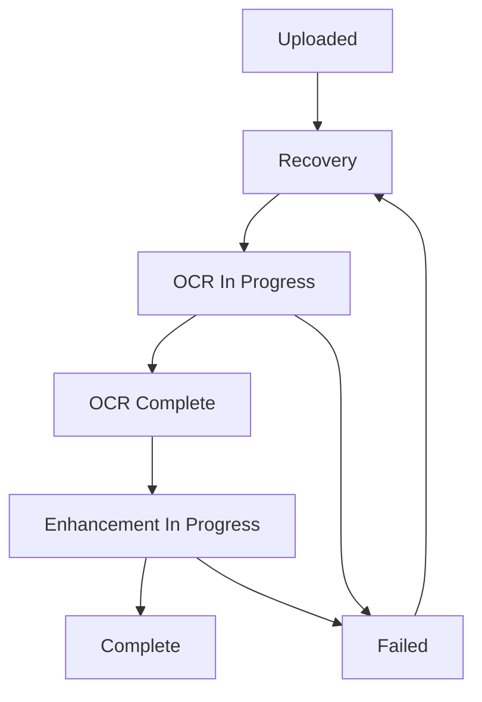
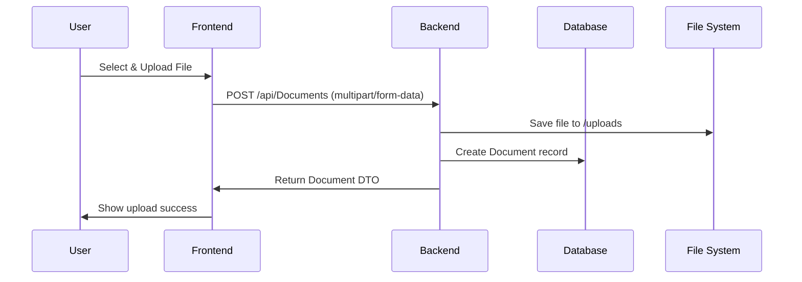
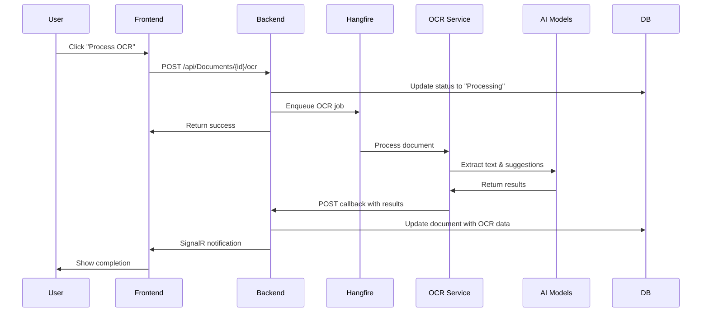
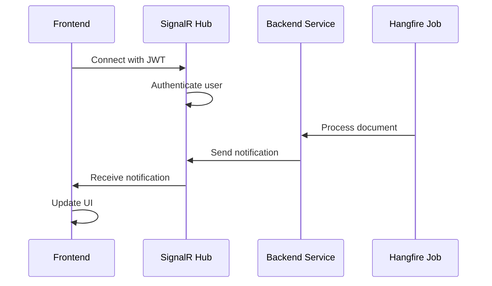
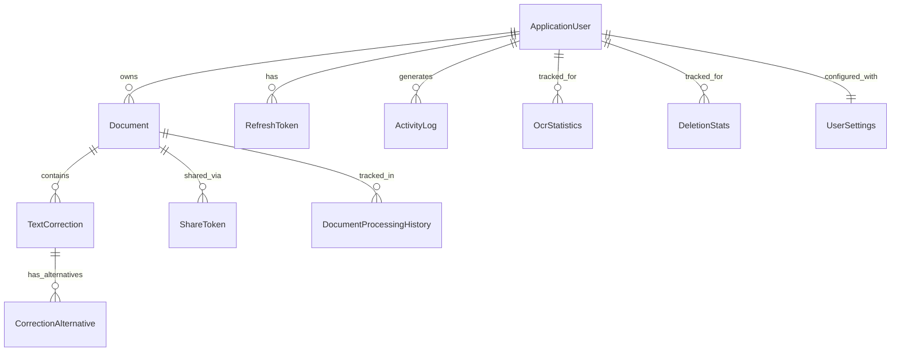

# 📋 OCRify - Complete Project Documentation

## 🎯 Project Overview

**OCRify** is a comprehensive, enterprise-grade **Optical Character Recognition (OCR) platform** that combines cutting-edge AI technologies to extract, enhance, and manage text from documents. The system supports multiple languages (English, French, Arabic) and provides intelligent text suggestions, corrections, and document management capabilities.

### 🏗️ Architecture Overview

OCRify follows a **microservices architecture** with four main components:

```
┌─────────────────┐    ┌─────────────────┐    ┌─────────────────┐    ┌─────────────────┐
│   Frontend      │    │    Backend      │    │  OCR Service    │    │   Database      │
│   (Vue.js)      │◄──►│   (.NET 8)      │◄──►│   (Python)      │    │ (SQL Server)    │
│   Port: 8080    │    │   Port: 5000    │    │   Port: 5002    │    │   Port: 1433    │
└─────────────────┘    └─────────────────┘    └─────────────────┘    └─────────────────┘
```

---

## 🛠️ Technology Stack

### **Frontend (OCRify)**
- **Framework**: Vue.js 3 with TypeScript
- **UI Library**: Tailwind CSS + shadcn/ui components
- **State Management**: Pinia
- **Routing**: Vue Router
- **Build Tool**: Vite
- **Authentication**: JWT + Google OAuth
- **Real-time**: SignalR client
- **HTTP Client**: Axios

### **Backend (PFE-Back)**
- **Framework**: .NET 8 Web API
- **Database**: Entity Framework Core with SQL Server
- **Authentication**: ASP.NET Core Identity + JWT
- **Real-time**: SignalR Hub
- **Background Jobs**: Hangfire
- **Email**: SendGrid
- **File Storage**: Local file system
- **Caching**: In-memory caching
- **Logging**: Serilog

### **OCR Service**
- **Framework**: Python FastAPI
- **OCR Engine**: Mistral AI OCR API
- **AI Models**: Ollama (Llama 3.2, Gemma)
- **Text Processing**: Advanced NLP algorithms
- **Image Processing**: PIL, PDF processing
- **API Documentation**: OpenAPI/Swagger

### **Database**
- **Primary**: Microsoft SQL Server 2022
- **ORM**: Entity Framework Core
- **Migrations**: Code-first approach
- **Indexing**: Optimized for performance

---

## 🔐 Authentication & Authorization

### **Authentication Flow**

1. **Registration/Login**:
   ```
   User → Frontend → Backend → Identity Validation → JWT Generation → Response
   ```

2. **Google OAuth**:
   ```
   User → Google → Frontend → Backend → User Creation/Login → JWT Response
   ```

3. **Token Management**:
   - **Access Token**: 60 minutes lifetime
   - **Refresh Token**: 7 days lifetime
   - **Automatic Refresh**: 5 minutes before expiration

### **Authorization Levels**
- **User**: Document management, OCR processing
- **Admin**: Full system access, user management, statistics

### **Security Features**
- Password hashing with ASP.NET Core Identity
- JWT token validation
- CORS protection
- Rate limiting
- Input sanitization
- SQL injection prevention

---

## 📄 Document Processing Workflow

### **Document Lifecycle States**



### **Processing Status Enum**
```csharp
public enum ProcessingStatus
{
    Uploaded = 0,           // Initial upload
    Processing = 1,         // Pre-OCR processing
    OcrInProgress = 2,      // OCR extraction running
    OcrComplete = 3,        // OCR finished successfully
    EnhancementInProgress = 4, // AI enhancement running
    Complete = 5,           // Fully processed
    Failed = 6              // Processing failed
}
```

### **OCR Processing Pipeline**

1. **File Upload**:
   - Validation (size, format, type)
   - Storage in `/uploads` directory
   - Database record creation

2. **OCR Extraction**:
   - Image preprocessing
   - Mistral AI OCR API call
   - Text extraction with confidence scores
   - Low-confidence word detection

3. **AI Enhancement**:
   - Ollama model processing
   - Context-aware suggestions
   - Grammar and spelling corrections
   - Language-specific optimizations

4. **Post-Processing**:
   - Summary generation
   - Metadata extraction
   - Final document completion

---

## 🗄️ Database Schema

### **Core Entities**

#### **ApplicationUser**
```csharp
public class ApplicationUser : IdentityUser<Guid>
{
    public string FirstName { get; set; }
    public string LastName { get; set; }
    public string ProfilePictureUrl { get; set; }
    public DateTime CreatedAt { get; set; }
    public DateTime? LastLoginDate { get; set; }
    public bool IsDeleted { get; set; }
    // Navigation properties
    public ICollection<Document> Documents { get; set; }
    public ICollection<RefreshToken> RefreshTokens { get; set; }
}
```

#### **Document**
```csharp
public class Document : AuditableEntity
{
    public Guid Id { get; set; }
    public Guid UserId { get; set; }
    public string FileName { get; set; }
    public string FilePath { get; set; }
    public long FileSize { get; set; }
    public string FileType { get; set; }
    public string Language { get; set; }
    public ProcessingStatus Status { get; set; }
    public string OcrText { get; set; }
    public string EnhancedText { get; set; }
    public string OcrResponse { get; set; }
    public string Summary { get; set; }
    public double? Accuracy { get; set; }
    public double? ProcessingTime { get; set; }
    // Navigation properties
    public ApplicationUser User { get; set; }
    public ICollection<TextCorrection> Corrections { get; set; }
}
```

### **Supporting Entities**
- **TextCorrection**: Manual text corrections
- **CorrectionAlternative**: Alternative correction suggestions
- **RefreshToken**: JWT refresh token management
- **ActivityLog**: User action tracking
- **ShareToken**: Document sharing tokens
- **OcrStatistics**: User OCR performance metrics
- **DocumentProcessingHistory**: Processing audit trail
- **UserSettings**: User preferences

---

## 🎨 Frontend Architecture

### **Component Structure**
```
src/
├── components/
│   ├── ui/                 # shadcn/ui components
│   ├── AppSidebar.vue      # Main navigation
│   ├── OCRPanel.vue        # OCR processing interface
│   ├── DocumentViewer.vue  # Document display
│   └── ThemeToggle.vue     # Dark/light mode
├── views/
│   ├── Dashboard.vue       # User dashboard
│   ├── Documents.vue       # Document management
│   ├── AdminDashboard.vue  # Admin interface
│   ├── Login.vue          # Authentication
│   └── Help.vue           # User documentation
├── services/
│   ├── api.ts             # API client
│   ├── auth-service.ts    # Authentication logic
│   └── signalr-service.ts # Real-time communication
└── types/
    └── documents.ts       # TypeScript interfaces
```

### **Key Features**

#### **Document Management**
- **Upload**: Drag-and-drop, bulk upload
- **Organization**: Tags, favorites, search, filtering
- **Sharing**: Secure token-based sharing
- **Export**: Multiple formats (Original, OCR, Enhanced)

#### **OCR Interface**
- **Real-time Processing**: Live progress updates
- **Interactive Editor**: Text editing with suggestions
- **Confidence Visualization**: Color-coded confidence levels
- **Language Detection**: Automatic language identification

#### **Admin Dashboard**
- **User Management**: CRUD operations, role management
- **System Statistics**: Real-time metrics, performance monitoring
- **Document Oversight**: All user documents, processing status
- **Activity Monitoring**: System-wide activity logs

---

## 🔧 Backend Services

### **Core Services**

#### **DocumentService**
- Document CRUD operations
- OCR workflow orchestration
- File management
- Statistics calculation
- Background job coordination

#### **AuthService**
- User registration/login
- JWT token management
- Google OAuth integration
- Password reset functionality

#### **OcrService**
- OCR API communication
- File preprocessing
- Result processing
- Error handling

#### **UserService**
- User management
- Profile operations
- Activity logging
- Admin functions

### **Background Jobs (Hangfire)**
- **OCR Processing**: Asynchronous document processing
- **Enhancement Jobs**: AI text improvement
- **Cleanup Tasks**: Temporary file removal
- **Statistics Updates**: Metric calculations

### **Real-time Communication (SignalR)**
- **Notifications**: Processing status updates
- **Progress Updates**: Real-time OCR progress
- **Admin Alerts**: System notifications

---

## 🤖 OCR Service Deep Dive

### **AI Models Integration**

#### **Mistral OCR API**
- **Purpose**: Primary text extraction
- **Capabilities**: Multi-language support, high accuracy
- **Output**: Raw text + confidence scores

#### **Ollama Models**
- **Llama 3.2**: General text enhancement
- **Gemma**: Lightweight processing
- **Arabic Model**: Arabic-specific optimizations

### **Advanced Features**

#### **Confidence Analysis**
```python
def calculate_document_confidence(text, low_confidence_words, language):
    # Multi-factor confidence calculation
    # - Word-level confidence scores
    # - Language-specific patterns
    # - Context coherence analysis
    # - Character recognition quality
```

#### **Smart Suggestions**
- **Context-aware**: Considers surrounding text
- **Language-specific**: Optimized for each language
- **Confidence-based**: Only suggests when confident
- **User-customizable**: Adjustable thresholds

#### **PII Detection**
- **Automatic scanning**: Identifies personal information
- **Privacy protection**: Flags sensitive content
- **Compliance**: GDPR/privacy regulation support

---

## 📊 Admin Panel Features

### **Dashboard Overview**
- **System Statistics**: Users, documents, processing metrics
- **Performance Monitoring**: Success rates, processing times
- **Resource Usage**: Storage, processing queue
- **Real-time Updates**: Auto-refresh every 30 seconds

### **User Management**
- **User CRUD**: Create, read, update, delete users
- **Role Management**: Admin/User role assignment
- **Bulk Operations**: Mass user operations
- **Account Recovery**: Restore deleted accounts

### **Document Oversight**
- **All Documents**: System-wide document view
- **Status Monitoring**: Processing status tracking
- **Performance Metrics**: OCR accuracy, processing times
- **Error Analysis**: Failed processing investigation

### **System Monitoring**
- **Activity Logs**: User action tracking
- **Performance Metrics**: System health monitoring
- **Error Tracking**: System error analysis
- **Usage Statistics**: Platform utilization metrics

---

## 🔄 API Endpoints

### **Authentication Endpoints**
```
POST /api/Auth/register          # User registration
POST /api/Auth/login             # User login
POST /api/Auth/google-auth       # Google OAuth
POST /api/Auth/refresh           # Token refresh
POST /api/Auth/forgot-password   # Password reset
POST /api/Auth/reset-password    # Password reset confirmation
```

### **Document Endpoints**
```
GET    /api/Documents            # Get user documents
POST   /api/Documents            # Upload document
GET    /api/Documents/{id}       # Get specific document
PUT    /api/Documents/{id}       # Update document
DELETE /api/Documents/{id}       # Delete document
POST   /api/Documents/{id}/ocr   # Trigger OCR
POST   /api/Documents/{id}/enhance # Trigger enhancement
```

### **Admin Endpoints**
```
GET /api/Dashboard/admin/stats     # Admin dashboard stats
GET /api/Dashboard/admin/ocr-stats # OCR statistics
GET /api/Users/admin/all          # All users (admin)
GET /api/Documents/admin/all      # All documents (admin)
```

### **OCR Service Endpoints**
```
POST /extract-text/              # OCR processing
GET  /suggestion-models          # Available AI models
GET  /health                     # Service health check
GET  /performance-metrics        # Performance monitoring
```

---

## 🚀 Deployment & Infrastructure

### **Docker Compose Architecture**
```yaml
services:
  database:     # SQL Server 2022
  backend:      # .NET 8 Web API
  ocr-service:  # Python FastAPI
  frontend:     # Vue.js + Nginx
```

### **Environment Configuration**
- **Development**: Local development setup
- **Production**: Containerized deployment
- **Environment Variables**: Secure configuration management
- **Health Checks**: Service monitoring

### **Security Considerations**
- **Network Isolation**: Docker network segmentation
- **Secret Management**: Environment-based secrets
- **HTTPS**: SSL/TLS encryption
- **CORS**: Cross-origin request protection

---

## 📈 Performance & Scalability

### **Optimization Features**
- **Caching**: In-memory and distributed caching
- **Background Processing**: Asynchronous job processing
- **Database Indexing**: Optimized query performance
- **File Compression**: Efficient storage management

### **Monitoring & Analytics**
- **Real-time Metrics**: Live performance monitoring
- **Usage Analytics**: User behavior tracking
- **Error Tracking**: Comprehensive error logging
- **Performance Profiling**: System bottleneck identification

---

## 🔧 Development & Maintenance

### **Code Quality**
- **TypeScript**: Type-safe frontend development
- **C# Best Practices**: Clean architecture patterns
- **Python Standards**: PEP 8 compliance
- **Code Reviews**: Systematic review process

### **Testing Strategy**
- **Unit Tests**: Component-level testing
- **Integration Tests**: Service interaction testing
- **End-to-End Tests**: Full workflow testing
- **Performance Tests**: Load and stress testing

### **Maintenance Procedures**
- **Database Migrations**: Schema evolution management
- **Dependency Updates**: Regular security updates
- **Backup Procedures**: Data protection strategies
- **Monitoring Alerts**: Proactive issue detection

---

## 👤 User Journey & Workflows

### **New User Registration**
1. **Account Creation**:
   - Email/password registration OR Google OAuth
   - Email verification (if using email/password)
   - Automatic user role assignment
   - Welcome notification

2. **First Login**:
   - Dashboard introduction
   - Feature tour
   - Sample document processing
   - Settings configuration

### **Document Processing Workflow**

#### **Standard User Workflow**
1. **Document Upload**:
   ```
   User selects file → Validation → Upload → Database record → Ready for processing
   ```

2. **OCR Processing**:
   ```
   User clicks "Process" → Status: Processing → OCR Service → Text extraction → Suggestions generation → Complete
   ```

3. **Text Enhancement**:
   ```
   User reviews OCR → Applies suggestions → Manual corrections → AI enhancement → Final document
   ```

4. **Document Management**:
   ```
   Organize with tags → Mark favorites → Share with others → Export in various formats
   ```

#### **Admin Workflow**
1. **System Monitoring**:
   - Real-time dashboard monitoring
   - Performance metrics analysis
   - Error investigation and resolution
   - User activity oversight

2. **User Management**:
   - User account administration
   - Role and permission management
   - Account recovery and restoration
   - Bulk user operations

3. **System Maintenance**:
   - Database optimization
   - Performance tuning
   - Security updates
   - Backup verification

---

## 🔍 Detailed Feature Analysis

### **OCR Processing Engine**

#### **Multi-Language Support**
- **English**: Optimized for Latin characters, technical documents
- **French**: Accent handling, specialized vocabulary
- **Arabic**: Right-to-left text, diacritics, ligatures, complex scripts

#### **Document Type Support**
- **PDF**: Multi-page processing, vector text extraction
- **Images**: PNG, JPG, JPEG, WEBP formats
- **Scanned Documents**: High-resolution image processing
- **Mobile Photos**: Auto-rotation, perspective correction

#### **Quality Enhancement Features**
- **Noise Reduction**: Image preprocessing for better OCR
- **Contrast Enhancement**: Automatic image optimization
- **Skew Correction**: Document alignment adjustment
- **Resolution Upscaling**: AI-powered image enhancement

### **AI-Powered Suggestions**

#### **Confidence-Based Suggestions**
```python
# Confidence thresholds by language
CONFIDENCE_THRESHOLDS = {
    "ara": {"base": 75, "single_char": 60, "diacritics": 80},
    "eng": {"base": 80, "single_char": 70, "numbers": 85},
    "fra": {"base": 78, "accents": 75, "proper_nouns": 75}
}
```

#### **Context-Aware Processing**
- **Semantic Analysis**: Understanding word relationships
- **Grammar Checking**: Language-specific grammar rules
- **Spell Correction**: Dictionary-based corrections
- **Technical Term Recognition**: Domain-specific vocabulary

#### **Learning Capabilities**
- **User Feedback Integration**: Learning from corrections
- **Pattern Recognition**: Identifying common errors
- **Adaptive Thresholds**: Dynamic confidence adjustment
- **Performance Optimization**: Continuous improvement

### **Document Security & Privacy**

#### **Access Control**
- **User Isolation**: Documents are user-specific
- **Admin Oversight**: Controlled admin access
- **Sharing Permissions**: Token-based secure sharing
- **Audit Trail**: Complete action logging

#### **Data Protection**
- **PII Detection**: Automatic personal information identification
- **Data Encryption**: At-rest and in-transit encryption
- **Secure Deletion**: Complete data removal
- **Compliance**: GDPR and privacy regulation adherence

#### **File Security**
- **Upload Validation**: File type and size restrictions
- **Virus Scanning**: Malware detection (configurable)
- **Secure Storage**: Protected file system access
- **Backup Encryption**: Encrypted backup procedures

---

## 🛡️ Security Architecture

### **Authentication Security**

#### **Password Security**
- **Hashing**: ASP.NET Core Identity with PBKDF2
- **Salt**: Unique salt per password
- **Complexity**: Configurable password requirements
- **Breach Protection**: Password breach detection

#### **JWT Security**
- **Algorithm**: HS256 with secure key
- **Expiration**: Short-lived access tokens
- **Refresh Mechanism**: Secure token refresh
- **Revocation**: Token blacklisting capability

#### **OAuth Integration**
- **Google OAuth 2.0**: Secure third-party authentication
- **Scope Limitation**: Minimal required permissions
- **Token Validation**: Server-side token verification
- **Account Linking**: Secure account association

### **API Security**

#### **Input Validation**
- **Model Validation**: Comprehensive DTO validation
- **SQL Injection Prevention**: Parameterized queries
- **XSS Protection**: Input sanitization
- **File Upload Security**: Type and size validation

#### **Rate Limiting**
- **Request Throttling**: Configurable rate limits
- **DDoS Protection**: Traffic spike handling
- **User-based Limits**: Per-user request quotas
- **API Endpoint Protection**: Endpoint-specific limits

#### **CORS Configuration**
```csharp
// Secure CORS policy
builder.Services.AddCors(options =>
{
    options.AddPolicy("AllowFrontend", builder =>
    {
        builder.WithOrigins(allowedOrigins)
               .AllowAnyMethod()
               .AllowAnyHeader()
               .AllowCredentials();
    });
});
```

### **Infrastructure Security**

#### **Network Security**
- **Docker Network Isolation**: Service segmentation
- **Internal Communication**: Secure inter-service communication
- **Port Restriction**: Minimal exposed ports
- **Firewall Configuration**: Network access control

#### **Container Security**
- **Base Image Security**: Regularly updated base images
- **Minimal Attack Surface**: Reduced container footprint
- **Non-root Execution**: Secure container runtime
- **Secret Management**: Environment-based secrets

---

## 📊 Performance Optimization

### **Database Performance**

#### **Indexing Strategy**
```sql
-- Key indexes for performance
CREATE INDEX IX_Documents_UserId ON Documents(UserId);
CREATE INDEX IX_Documents_Status ON Documents(Status);
CREATE INDEX IX_Documents_UploadDate ON Documents(UploadDate);
CREATE INDEX IX_ActivityLogs_UserId_Timestamp ON ActivityLogs(UserId, Timestamp);
```

#### **Query Optimization**
- **Entity Framework Optimization**: Efficient LINQ queries
- **Lazy Loading**: Strategic lazy loading configuration
- **Bulk Operations**: Optimized bulk insert/update
- **Connection Pooling**: Database connection management

#### **Caching Strategy**
- **In-Memory Caching**: Frequently accessed data
- **Distributed Caching**: Scalable caching solution
- **Cache Invalidation**: Smart cache refresh
- **Cache Warming**: Proactive cache population

### **Frontend Performance**

#### **Bundle Optimization**
- **Code Splitting**: Dynamic imports for large components
- **Tree Shaking**: Unused code elimination
- **Minification**: Production build optimization
- **Compression**: Gzip/Brotli compression

#### **Runtime Performance**
- **Virtual Scrolling**: Large list optimization
- **Lazy Loading**: Component lazy loading
- **Memoization**: Computed property caching
- **Debouncing**: Input optimization

#### **Asset Optimization**
- **Image Optimization**: WebP format, responsive images
- **Font Loading**: Optimized web font loading
- **CSS Optimization**: Critical CSS inlining
- **JavaScript Optimization**: Modern ES modules

### **OCR Service Performance**

#### **Processing Optimization**
- **Parallel Processing**: Concurrent word processing
- **Batch Operations**: Efficient batch processing
- **Memory Management**: Optimized memory usage
- **Timeout Configuration**: Appropriate timeout settings

#### **AI Model Optimization**
- **Model Selection**: Optimal model for task
- **Context Window**: Efficient context management
- **Suggestion Caching**: Repeated suggestion caching
- **Load Balancing**: Model request distribution

---

## 🔧 Configuration Management

### **Environment Configuration**

#### **Development Environment**
```bash
# Development settings
ASPNETCORE_ENVIRONMENT=Development
DB_CONNECTION_STRING=Server=localhost;Database=OCRify_Dev;...
JWT_KEY=development_secret_key
LOG_LEVEL=Debug
CACHE_ENABLED=false
```

#### **Production Environment**
```bash
# Production settings
ASPNETCORE_ENVIRONMENT=Production
DB_CONNECTION_STRING=Server=prod-db;Database=OCRify_Prod;...
JWT_KEY=${SECURE_JWT_KEY}
LOG_LEVEL=Information
CACHE_ENABLED=true
```

### **Feature Flags**
- **Cache Configuration**: Enable/disable caching
- **User Management**: Control user restoration features
- **Logging Levels**: Configurable logging verbosity
- **Performance Monitoring**: Enable/disable metrics collection

### **Service Configuration**

#### **OCR Service Settings**
```python
CONFIG = {
    "MISTRAL_OCR_MODEL": "pixtral-12b-2409",
    "OLLAMA_API_BASE": "http://host.docker.internal:11434/api",
    "MAX_CONCURRENT_WORDS": 5,
    "SUGGESTION_TIMEOUT": 60,
    "PII_DETECTION_TIMEOUT": 30
}
```

#### **Backend Settings**
```json
{
  "JwtSettings": {
    "TokenLifetimeMinutes": 60,
    "RefreshTokenLifetimeDays": 7
  },
  "SendGrid": {
    "ApiKey": "${SENDGRID_API_KEY}",
    "FromEmail": "noreply@ocrify.com"
  }
}
```

---

## 🧪 Testing Strategy

### **Frontend Testing**

#### **Unit Testing**
- **Component Testing**: Vue component isolation testing
- **Service Testing**: API service function testing
- **Utility Testing**: Helper function validation
- **Store Testing**: Pinia store logic testing

#### **Integration Testing**
- **API Integration**: Frontend-backend communication
- **Authentication Flow**: Login/logout workflows
- **Document Upload**: File upload process
- **Real-time Features**: SignalR connection testing

#### **E2E Testing**
- **User Workflows**: Complete user journey testing
- **Cross-browser Testing**: Browser compatibility
- **Mobile Testing**: Responsive design validation
- **Performance Testing**: Frontend performance metrics

### **Backend Testing**

#### **Unit Testing**
- **Service Testing**: Business logic validation
- **Controller Testing**: API endpoint testing
- **Repository Testing**: Data access testing
- **Utility Testing**: Helper method validation

#### **Integration Testing**
- **Database Testing**: Entity Framework integration
- **External API Testing**: OCR service communication
- **Authentication Testing**: Identity system testing
- **Background Job Testing**: Hangfire job execution

#### **Performance Testing**
- **Load Testing**: High-traffic simulation
- **Stress Testing**: System limit testing
- **Database Performance**: Query performance testing
- **Memory Testing**: Memory leak detection

### **OCR Service Testing**

#### **Functional Testing**
- **OCR Accuracy**: Text extraction validation
- **Language Support**: Multi-language testing
- **Suggestion Quality**: AI suggestion validation
- **Error Handling**: Failure scenario testing

#### **Performance Testing**
- **Processing Speed**: OCR performance benchmarks
- **Concurrent Processing**: Multi-user testing
- **Memory Usage**: Resource consumption testing
- **API Response Time**: Service latency testing

---

## 📈 Monitoring & Analytics

### **Application Monitoring**

#### **Performance Metrics**
- **Response Times**: API endpoint performance
- **Throughput**: Requests per second
- **Error Rates**: System error tracking
- **Resource Usage**: CPU, memory, disk usage

#### **Business Metrics**
- **User Activity**: Active user tracking
- **Document Processing**: OCR success rates
- **Feature Usage**: Feature adoption metrics
- **User Satisfaction**: Performance satisfaction

#### **Health Checks**
```csharp
// Health check configuration
app.MapHealthChecks("/health", new HealthCheckOptions
{
    ResponseWriter = UIResponseWriter.WriteHealthCheckUIResponse
});
```

### **Logging Strategy**

#### **Structured Logging**
- **Serilog Integration**: Structured log format
- **Log Levels**: Appropriate log level usage
- **Context Enrichment**: Request context logging
- **Performance Logging**: Operation timing

#### **Log Aggregation**
- **Centralized Logging**: Log collection system
- **Log Analysis**: Pattern recognition
- **Alert Configuration**: Critical error alerts
- **Log Retention**: Appropriate retention policies

### **Error Tracking**

#### **Error Monitoring**
- **Exception Tracking**: Comprehensive error capture
- **Error Categorization**: Error type classification
- **Error Trends**: Error pattern analysis
- **Resolution Tracking**: Error fix monitoring

#### **User Experience Monitoring**
- **Frontend Errors**: JavaScript error tracking
- **API Errors**: Backend error monitoring
- **Performance Issues**: Slow operation detection
- **User Feedback**: Error report collection

---

## 🚀 Deployment Guide

### **Prerequisites**
- Docker & Docker Compose
- .NET 8 SDK (for development)
- Node.js 18+ (for development)
- Python 3.9+ (for OCR service development)
- SQL Server 2022 (or Docker container)

### **Production Deployment**

#### **1. Environment Setup**
```bash
# Clone repository
git clone <repository-url>
cd ocrify-platform

# Create environment files
cp .env.example .env
# Configure environment variables
```

#### **2. Docker Deployment**
```bash
# Build and start all services
docker-compose up -d

# Verify deployment
docker-compose ps
docker-compose logs -f
```

#### **3. Database Migration**
```bash
# Run database migrations
docker-compose exec backend dotnet ef database update
```

#### **4. Health Verification**
```bash
# Check service health
curl http://localhost:5000/health
curl http://localhost:5002/health
curl http://localhost:8080
```

### **Development Setup**

#### **Backend Development**
```bash
cd PFE-Back
dotnet restore
dotnet ef database update
dotnet run
```

#### **Frontend Development**
```bash
cd OCRify
npm install
npm run dev
```

#### **OCR Service Development**
```bash
cd ocr-service
pip install -r requirements.txt
uvicorn ai_endpoint2:app --reload --port 5002
```

---

## 🔄 Data Flow Architecture

### **Document Upload Flow**


### **OCR Processing Flow**


### **Real-time Communication Flow**


---

## 🗃️ Database Design Deep Dive

### **Entity Relationships**


### **Key Database Patterns**

#### **Soft Delete Pattern**
```csharp
public abstract class AuditableEntity
{
    public Guid CreatedBy { get; set; }
    public DateTime CreatedAt { get; set; }
    public Guid? UpdatedBy { get; set; }
    public DateTime? UpdatedAt { get; set; }
    public Guid? DeletedBy { get; set; }
    public DateTime? DeletedAt { get; set; }
    public bool IsDeleted { get; set; }
}
```

#### **Audit Trail Implementation**
```csharp
public class ActivityLog
{
    public Guid Id { get; set; }
    public Guid UserId { get; set; }
    public string Action { get; set; }
    public string Details { get; set; }
    public DateTime Timestamp { get; set; }
    public string IpAddress { get; set; }
    public string UserAgent { get; set; }
}
```

#### **Token Management**
```csharp
public class RefreshToken
{
    public Guid Id { get; set; }
    public Guid UserId { get; set; }
    public string Token { get; set; }
    public DateTime ExpiryDate { get; set; }
    public bool IsRevoked { get; set; }
    public ApplicationUser User { get; set; }
}
```

### **Performance Optimizations**

#### **Strategic Indexing**
```sql
-- High-performance indexes
CREATE INDEX IX_Documents_UserId_Status ON Documents(UserId, Status);
CREATE INDEX IX_Documents_UploadDate_DESC ON Documents(UploadDate DESC);
CREATE INDEX IX_ActivityLogs_UserId_Timestamp ON ActivityLogs(UserId, Timestamp);
CREATE INDEX IX_RefreshTokens_Token ON RefreshTokens(Token);
CREATE INDEX IX_ShareTokens_Token ON ShareTokens(Token);
```

#### **Query Optimization Examples**
```csharp
// Optimized document retrieval
public async Task<PagedResult<Document>> GetUserDocumentsAsync(
    Guid userId, DocumentSearchDto search)
{
    var query = _context.Documents
        .Where(d => d.UserId == userId && !d.IsDeleted)
        .Include(d => d.Corrections.Take(5)) // Limit included data
        .AsNoTracking(); // Read-only optimization

    if (!string.IsNullOrEmpty(search.SearchTerm))
    {
        query = query.Where(d =>
            d.FileName.Contains(search.SearchTerm) ||
            d.OcrText.Contains(search.SearchTerm));
    }

    return await query
        .OrderByDescending(d => d.UploadDate)
        .Skip((search.Page - 1) * search.PageSize)
        .Take(search.PageSize)
        .ToListAsync();
}
```

---

## 🎯 Advanced OCR Features

### **Language-Specific Processing**

#### **Arabic Text Processing**
```python
class ArabicTextProcessor:
    def __init__(self):
        self.diacritic_patterns = {
            'fatha': '\u064E',
            'kasra': '\u0650',
            'damma': '\u064F',
            'sukun': '\u0652',
            'shadda': '\u0651'
        }

    def normalize_arabic_text(self, text):
        # Remove diacritics for better matching
        normalized = re.sub(r'[\u064B-\u065F\u0670\u0640]', '', text)
        # Normalize alef variations
        normalized = re.sub(r'[آأإ]', 'ا', normalized)
        # Normalize teh marbuta
        normalized = re.sub(r'ة', 'ه', normalized)
        return normalized

    def detect_text_direction(self, text):
        arabic_chars = len(re.findall(r'[\u0600-\u06FF]', text))
        total_chars = len(re.findall(r'[^\s\d\W]', text))
        return 'rtl' if arabic_chars / total_chars > 0.5 else 'ltr'
```

#### **French Text Processing**
```python
class FrenchTextProcessor:
    def __init__(self):
        self.accent_map = {
            'à': 'a', 'á': 'a', 'â': 'a', 'ã': 'a', 'ä': 'a',
            'è': 'e', 'é': 'e', 'ê': 'e', 'ë': 'e',
            'ì': 'i', 'í': 'i', 'î': 'i', 'ï': 'i',
            'ò': 'o', 'ó': 'o', 'ô': 'o', 'õ': 'o', 'ö': 'o',
            'ù': 'u', 'ú': 'u', 'û': 'u', 'ü': 'u',
            'ç': 'c', 'ñ': 'n'
        }

    def suggest_accent_corrections(self, word):
        # Generate accent variations for common French words
        suggestions = []
        for i, char in enumerate(word):
            if char.lower() in 'aeiou':
                for accented, base in self.accent_map.items():
                    if base == char.lower():
                        suggestion = word[:i] + accented + word[i+1:]
                        suggestions.append(suggestion)
        return suggestions
```

### **Advanced Confidence Calculation**

#### **Multi-Factor Confidence Algorithm**
```python
def calculate_advanced_confidence(word_data, context, language):
    factors = {
        'character_confidence': 0.3,
        'dictionary_match': 0.25,
        'context_coherence': 0.2,
        'language_model': 0.15,
        'visual_quality': 0.1
    }

    scores = {}

    # Character-level confidence
    char_confidences = [c.confidence for c in word_data.characters]
    scores['character_confidence'] = sum(char_confidences) / len(char_confidences)

    # Dictionary matching
    scores['dictionary_match'] = check_dictionary_match(word_data.text, language)

    # Context coherence
    scores['context_coherence'] = analyze_context_fit(word_data.text, context)

    # Language model probability
    scores['language_model'] = get_language_model_score(word_data.text, context)

    # Visual quality assessment
    scores['visual_quality'] = assess_visual_quality(word_data.bounding_box)

    # Weighted average
    final_confidence = sum(scores[factor] * weight
                          for factor, weight in factors.items())

    return min(max(final_confidence, 0.0), 1.0)
```

### **Smart Suggestion Engine**

#### **Context-Aware Suggestions**
```python
async def generate_smart_suggestions(word, context, language, confidence):
    suggestions = []

    if confidence < CONFIDENCE_THRESHOLDS[language]['base']:
        # Dictionary-based suggestions
        dict_suggestions = await get_dictionary_suggestions(word, language)
        suggestions.extend(dict_suggestions)

        # Phonetic similarity suggestions
        phonetic_suggestions = await get_phonetic_suggestions(word, language)
        suggestions.extend(phonetic_suggestions)

        # Context-based suggestions
        if context:
            context_suggestions = await get_context_suggestions(
                word, context, language)
            suggestions.extend(context_suggestions)

        # AI model suggestions
        if len(suggestions) < 3:
            ai_suggestions = await get_ai_model_suggestions(
                word, context, language)
            suggestions.extend(ai_suggestions)

    # Rank and filter suggestions
    ranked_suggestions = rank_suggestions(suggestions, word, context)
    return ranked_suggestions[:5]  # Top 5 suggestions
```

---

## 🔐 Advanced Security Features

### **JWT Security Implementation**

#### **Token Generation & Validation**
```csharp
public class JwtService
{
    private readonly IConfiguration _configuration;
    private readonly byte[] _key;

    public JwtService(IConfiguration configuration)
    {
        _configuration = configuration;
        _key = Encoding.UTF8.GetBytes(_configuration["JwtSettings:SecretKey"]);
    }

    public string GenerateAccessToken(ApplicationUser user, IList<string> roles)
    {
        var tokenHandler = new JwtSecurityTokenHandler();
        var claims = new List<Claim>
        {
            new(ClaimTypes.NameIdentifier, user.Id.ToString()),
            new(ClaimTypes.Email, user.Email),
            new(ClaimTypes.Name, $"{user.FirstName} {user.LastName}"),
            new("jti", Guid.NewGuid().ToString()),
            new("iat", DateTimeOffset.UtcNow.ToUnixTimeSeconds().ToString())
        };

        claims.AddRange(roles.Select(role => new Claim(ClaimTypes.Role, role)));

        var tokenDescriptor = new SecurityTokenDescriptor
        {
            Subject = new ClaimsIdentity(claims),
            Expires = DateTime.UtcNow.AddMinutes(
                _configuration.GetValue<int>("JwtSettings:TokenLifetimeMinutes")),
            SigningCredentials = new SigningCredentials(
                new SymmetricSecurityKey(_key),
                SecurityAlgorithms.HmacSha256Signature),
            Issuer = _configuration["JwtSettings:Issuer"],
            Audience = _configuration["JwtSettings:Audience"]
        };

        var token = tokenHandler.CreateToken(tokenDescriptor);
        return tokenHandler.WriteToken(token);
    }
}
```

#### **Refresh Token Security**
```csharp
public class RefreshTokenService
{
    public async Task<string> GenerateRefreshTokenAsync(Guid userId)
    {
        var refreshToken = new RefreshToken
        {
            Id = Guid.NewGuid(),
            UserId = userId,
            Token = GenerateSecureToken(),
            ExpiryDate = DateTime.UtcNow.AddDays(7),
            IsRevoked = false
        };

        _context.RefreshTokens.Add(refreshToken);
        await _context.SaveChangesAsync();

        return refreshToken.Token;
    }

    private string GenerateSecureToken()
    {
        using var rng = RandomNumberGenerator.Create();
        var bytes = new byte[64];
        rng.GetBytes(bytes);
        return Convert.ToBase64String(bytes);
    }

    public async Task<bool> ValidateRefreshTokenAsync(string token)
    {
        var refreshToken = await _context.RefreshTokens
            .FirstOrDefaultAsync(rt => rt.Token == token &&
                               !rt.IsRevoked &&
                               rt.ExpiryDate > DateTime.UtcNow);

        return refreshToken != null;
    }
}
```

### **Input Validation & Sanitization**

#### **Comprehensive DTO Validation**
```csharp
public class DocumentUploadDto
{
    [Required(ErrorMessage = "File is required")]
    [FileExtensions(Extensions = "pdf,png,jpg,jpeg,webp",
                   ErrorMessage = "Invalid file format")]
    [MaxFileSize(50 * 1024 * 1024, ErrorMessage = "File size cannot exceed 50MB")]
    public IFormFile File { get; set; }

    [Required]
    [StringLength(100, MinimumLength = 1)]
    [RegularExpression(@"^[a-zA-Z0-9\s\-_.]+$",
                      ErrorMessage = "Invalid characters in filename")]
    public string FileName { get; set; }

    [Required]
    [StringLength(10)]
    [RegularExpression(@"^(eng|fra|ara)$",
                      ErrorMessage = "Unsupported language")]
    public string Language { get; set; }

    [StringLength(500)]
    [RegularExpression(@"^[a-zA-Z0-9\s\-_.,:;!?]+$",
                      ErrorMessage = "Invalid characters in description")]
    public string? Description { get; set; }

    [MaxLength(10)]
    public List<string> Tags { get; set; } = new();
}

public class MaxFileSizeAttribute : ValidationAttribute
{
    private readonly int _maxFileSize;

    public MaxFileSizeAttribute(int maxFileSize)
    {
        _maxFileSize = maxFileSize;
    }

    protected override ValidationResult IsValid(object value, ValidationContext validationContext)
    {
        if (value is IFormFile file && file.Length > _maxFileSize)
        {
            return new ValidationResult(ErrorMessage);
        }
        return ValidationResult.Success;
    }
}
```

### **API Rate Limiting**

#### **Advanced Rate Limiting Implementation**
```csharp
public class RateLimitingMiddleware
{
    private readonly RequestDelegate _next;
    private readonly IMemoryCache _cache;
    private readonly IConfiguration _configuration;

    public RateLimitingMiddleware(RequestDelegate next, IMemoryCache cache, IConfiguration configuration)
    {
        _next = next;
        _cache = cache;
        _configuration = configuration;
    }

    public async Task InvokeAsync(HttpContext context)
    {
        var endpoint = context.GetEndpoint();
        var rateLimitAttribute = endpoint?.Metadata.GetMetadata<RateLimitAttribute>();

        if (rateLimitAttribute != null)
        {
            var clientId = GetClientIdentifier(context);
            var key = $"rate_limit_{rateLimitAttribute.Resource}_{clientId}";

            var requestCount = _cache.Get<int>(key);

            if (requestCount >= rateLimitAttribute.MaxRequests)
            {
                context.Response.StatusCode = 429;
                await context.Response.WriteAsync("Rate limit exceeded");
                return;
            }

            _cache.Set(key, requestCount + 1, TimeSpan.FromMinutes(rateLimitAttribute.WindowMinutes));
        }

        await _next(context);
    }

    private string GetClientIdentifier(HttpContext context)
    {
        // Use user ID if authenticated, otherwise IP address
        var userId = context.User.FindFirst(ClaimTypes.NameIdentifier)?.Value;
        return userId ?? context.Connection.RemoteIpAddress?.ToString() ?? "unknown";
    }
}

[AttributeUsage(AttributeTargets.Method | AttributeTargets.Class)]
public class RateLimitAttribute : Attribute
{
    public string Resource { get; set; }
    public int MaxRequests { get; set; }
    public int WindowMinutes { get; set; }

    public RateLimitAttribute(string resource, int maxRequests, int windowMinutes)
    {
        Resource = resource;
        MaxRequests = maxRequests;
        WindowMinutes = windowMinutes;
    }
}
```

---

This comprehensive documentation now covers all aspects of the OCRify platform in extreme detail, providing both high-level architectural understanding and deep technical implementation specifics. The documentation serves as a complete guide for developers, administrators, and stakeholders to understand, deploy, maintain, and extend the platform.
